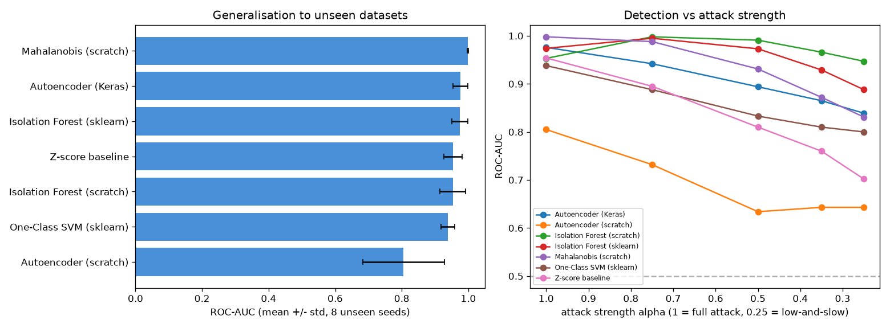

# Robust evaluation (auto-generated by `src/robust_evaluation.py`)

Setup: 8 unseen seeds, 200 users, 10 red-team insiders per dataset, 
28 behavioural features. Labels are used only to score rankings, never to train.

## Experiment 1 - ROC-AUC / precision@k / recall@k (mean, std over seeds)

| model                      |   ('roc_auc', 'mean') |   ('roc_auc', 'std') |   ('precision@k', 'mean') |   ('precision@k', 'std') |   ('recall@k', 'mean') |   ('recall@k', 'std') |
|:---------------------------|----------------------:|---------------------:|--------------------------:|-------------------------:|-----------------------:|----------------------:|
| Autoencoder (Keras)        |                 0.976 |                0.023 |                     0.85  |                    0.076 |                  0.85  |                 0.076 |
| Autoencoder (scratch)      |                 0.805 |                0.123 |                     0.588 |                    0.155 |                  0.588 |                 0.155 |
| Isolation Forest (scratch) |                 0.953 |                0.039 |                     0.662 |                    0.13  |                  0.662 |                 0.13  |
| Isolation Forest (sklearn) |                 0.974 |                0.024 |                     0.825 |                    0.089 |                  0.825 |                 0.089 |
| Mahalanobis (scratch)      |                 0.998 |                0.002 |                     0.938 |                    0.052 |                  0.938 |                 0.052 |
| One-Class SVM (sklearn)    |                 0.938 |                0.021 |                     0.825 |                    0.046 |                  0.825 |                 0.046 |
| Z-score baseline           |                 0.954 |                0.027 |                     0.838 |                    0.074 |                  0.838 |                 0.074 |

## Experiment 2 - mean ROC-AUC as the attack is weakened (alpha)

| model                      |   1.0 |   0.75 |   0.5 |   0.35 |   0.25 |
|:---------------------------|------:|-------:|------:|-------:|-------:|
| Autoencoder (Keras)        | 0.976 |  0.942 | 0.894 |  0.865 |  0.839 |
| Autoencoder (scratch)      | 0.805 |  0.732 | 0.634 |  0.643 |  0.643 |
| Isolation Forest (scratch) | 0.953 |  0.998 | 0.991 |  0.966 |  0.947 |
| Isolation Forest (sklearn) | 0.974 |  0.995 | 0.973 |  0.929 |  0.888 |
| Mahalanobis (scratch)      | 0.998 |  0.988 | 0.931 |  0.872 |  0.831 |
| One-Class SVM (sklearn)    | 0.938 |  0.888 | 0.833 |  0.81  |  0.8   |
| Z-score baseline           | 0.954 |  0.895 | 0.81  |  0.76  |  0.702 |

